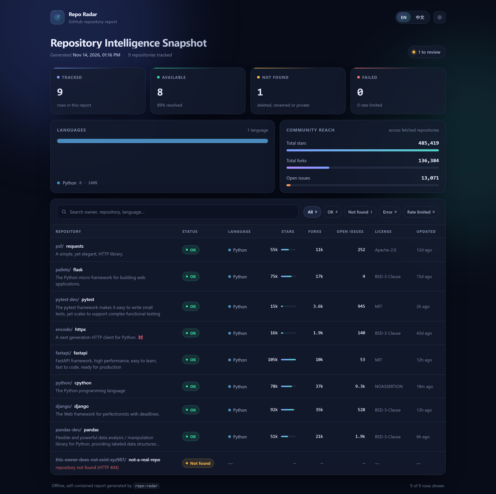

# Repo Radar

**English** · [简体中文](README.zh-CN.md)

Turn a plain list of `owner/repository` pairs into a clean, shareable snapshot of
what those projects look like today — CSV, JSON, and a self-contained HTML
dashboard.



<sub>Real output of `repo-radar sample_repos.csv --output-format all` — no mock data,
no server, one HTML file you can open from disk or attach to a ticket.</sub>

---

## Why this exists

Most "fetch repo stats" scripts are a loop around an HTTP call. Repo Radar is the
version you would keep: it validates its input, respects GitHub's rate limits,
isolates per-item failures, writes every report atomically, and ships with a test
suite that never touches the network.

It is an independently developed portfolio project built on the public GitHub REST
API. It is a well-tested automation tool, not a production service, and it makes no
enterprise-grade claims.

## Features

- **Input that survives real spreadsheets** — required-column validation, GitHub
  naming rules, whitespace trimming, case-insensitive headers, UTF-8 BOM handling
  (Excel), duplicate removal, and per-row error isolation: one bad line never
  aborts the run.
- **GitHub REST client with opinions** — `GET /repos/{owner}/{repo}` via `requests`,
  per-request timeouts, exponential backoff, `Retry-After` support with a hard cap,
  and typed errors (`RepositoryNotFoundError`, `RateLimitError`, `GitHubServerError`).
- **Bounded concurrency** — a `--workers` thread pool (default 4, hard cap 32) that
  never queues more work than it can run. Results are reassembled in input order
  regardless of completion order.
- **Rate-limit awareness** — a primary rate limit (HTTP 403 with
  `X-RateLimit-Remaining: 0`) stops the run instead of hammering the API; 429/5xx are
  retried with backoff.
- **Three report formats** — CSV, JSON, and a single-file HTML dashboard
  (`--output-format csv|json|html|both|all`).
- **A dashboard that works offline** — no CDN, no build step, no server: KPI cards,
  language breakdown, community reach, search, status filters, sortable columns,
  dark/light themes and an English/中文 switch, all inside one file.
- **Atomic writes** — reports are written to a temporary sibling and then moved into
  place, so a crash never leaves a half-written CSV.
- **Layered settings** — CLI flag > environment variable > `.env` file > built-in
  default, documented and tested.
- **Packaging** — `pip install -e .` exposes a `repo-radar` console command;
  `python -m src.main` works too.
- **135 offline tests** — all HTTP mocked, deterministic, no network; plus `ruff`
  lint/format checks and GitHub Actions CI on Python 3.11, 3.12 and 3.13.

## Install

Requires Python 3.11+.

```bash
git clone https://github.com/<your-account>/repo-radar.git
cd repo-radar

python -m venv .venv
source .venv/bin/activate          # Windows: .venv\Scripts\activate

pip install -e ".[dev]"            # runtime + pytest + pytest-cov + ruff
```

Not published to PyPI; install from a clone.

## Quick start

```bash
repo-radar sample_repos.csv --output-format all
# or, equivalently:
python -m src.main sample_repos.csv --output-format all
```

```
output/repository_report.csv     # flat table, 18 stable columns
output/repository_report.json    # same rows with a small envelope
output/repository_report.html    # the dashboard shown above
```

Open the HTML file in any browser — it needs no network and no server.

## CLI reference

| Option | Default | Description |
| --- | --- | --- |
| `input` (positional) | — | Path to the input CSV |
| `--input` | — | Same as the positional argument |
| `--output-dir` | `output` | Directory for the generated reports |
| `--output-format` | `both` | `csv`, `json`, `html`, `both` (csv+json), `all` (csv+json+html) |
| `--lang` | `en` | Initial language of the HTML report (`en`, `zh`); switchable in the page |
| `--token` | `$GITHUB_TOKEN` | GitHub token (prefer the environment variable) |
| `--timeout` | `10.0` | Per-request timeout in seconds |
| `--max-retries` | `3` | Retry attempts per request |
| `--workers` | `4` | Concurrent requests, 1–32 |
| `-v, --verbose` | off | Debug logging |
| `--no-color` | off | Disable ANSI colours (also honoured: `NO_COLOR`) |

`--output-format both` keeps its original meaning (CSV + JSON) so existing scripts
behave exactly as before; `all` adds the HTML dashboard.

### Settings precedence

```
CLI flag  >  environment variable  >  .env file  >  built-in default
```

| Variable | Used for |
| --- | --- |
| `GITHUB_TOKEN` | GitHub authentication |
| `REPO_RADAR_TIMEOUT` | per-request timeout (seconds) |
| `REPO_RADAR_MAX_RETRIES` | retry attempts per request |
| `REPO_RADAR_WORKERS` | concurrent requests |

Copy `.env.example` to `.env` (gitignored) to set them locally; real environment
variables always override the file. Invalid values — a non-numeric timeout,
`--workers 0`, `--workers 99` — are rejected with exit code 2.

## Input format

A CSV with two columns, `owner` and `repository`. Extra columns are ignored,
whitespace is trimmed, blank lines are skipped and duplicates are removed:

```csv
owner,repository
psf,requests
pallets,flask
pytest-dev,pytest
encode,httpx
fastapi,fastapi
python,cpython
django,django
pandas-dev,pandas
this-owner-does-not-exist-xyz987,not-a-real-repo
```

The last row points at a repository that does not exist on purpose, to demonstrate
error isolation. Names are validated against GitHub's naming rules; rows that fail
validation are logged with their line number and skipped.

## Output

### CSV and JSON

Both files keep a stable column order (18 columns: identity, status, metadata,
timestamps, `error_message`).

```csv
owner,repository,full_name,status,url,description,language,stars,forks,open_issues,archived,default_branch,license
psf,requests,psf/requests,ok,https://github.com/psf/requests,"A simple, yet elegant, HTTP library.",Python,54698,11433,252,False,main,Apache-2.0
this-owner-does-not-exist-xyz987,not-a-real-repo,...,not_found,...,...,...,0,0,0,False,,,
```

```json
{
  "generated_at": "2026-11-14T13:09:41Z",
  "total": 9,
  "repositories": [
    {
      "owner": "psf",
      "repository": "requests",
      "full_name": "psf/requests",
      "status": "ok",
      "stars": 54698,
      "license": "Apache-2.0",
      "error_message": ""
    }
  ]
}
```

### HTML dashboard

One self-contained file — inline CSS, inline JS, the report data embedded as JSON.
What is inside:

| Area | What it shows |
| --- | --- |
| KPI cards | tracked rows, resolved repositories, not-found, failures |
| Languages | stacked share bar plus a legend with counts and percentages |
| Community reach | total stars, forks and open issues across fetched repositories |
| Table | status pill, language, stars (with relative bar), forks, issues, licence, last push |
| Toolbar | free-text search (`/` to focus), status filters, sortable columns |
| Chrome | light/dark theme (remembered), English/中文 switch, generated timestamp |

Add `?lang=zh` or `?theme=light` to the file URL to force a starting state — handy
for deterministic screenshots and for embedding in docs.

## Error handling

Every input row produces exactly one report row with a `status`:

| Status | Meaning |
| --- | --- |
| `ok` | metadata fetched successfully |
| `not_found` | HTTP 404 — repository does not exist |
| `rate_limited` | GitHub rate limit hit; the run stopped early |
| `error` | any other API/network failure after retries |

Exit codes, for cron and CI:

| Code | Meaning |
| --- | --- |
| `0` | run completed (at least one repository fetched) |
| `1` | run completed but nothing could be fetched |
| `2` | invalid input or configuration, or the reports could not be written |

Concurrency semantics are explicit: a primary rate limit stops the run — no new
request is submitted, requests already in flight may finish, and items never started
are dropped from the report. A failed or skipped repository never affects the others,
and results always keep the input order.

## Architecture

```
Input CSV            sample_repos.csv
   ↓
Validation           src/csv_loader.py     CSV parsing, naming rules, dedup
   ↓
Fetching             src/processor.py      sequential or bounded thread pool
   ↓                                        (per-item isolation, stop on rate limit)
HTTP / rate control  src/github_client.py  timeouts, retry + backoff, Retry-After,
   ↓                                        per-thread sessions, typed errors
Normalization        src/models.py          RepoRequest / RepoReport, REPORT_COLUMNS
   ↓
Report generation    src/report_writer.py  CSV + JSON (atomic writes)
                     src/html_report.py    HTML dashboard (template + embedded JSON)
   ↓
CLI                  src/main.py            argparse, settings precedence, exit codes
```

Dependency rule: only `github_client.py` imports `requests`. The processor depends on
a `RepoClient` protocol (one method plus typed exceptions) injected by the CLI layer,
so tests substitute fake clients and the whole suite runs offline.

`src/pagination.py` is a tested, generic pagination helper (`Page`, `paginate()`,
GitHub `Link`-header parsing) kept ready for future list endpoints; the current
single-object endpoint does not paginate, so the main flow does not use it.

## Testing

```bash
pytest -q --cov=src --cov-report=term-missing   # 135 tests, 96% coverage
ruff check .                                    # pycodestyle, pyflakes, isort, bugbear
ruff format --check .
```

The suite covers input validation, retry/backoff behaviour (including the
`Retry-After` cap), error mapping (404 / 403 / 429 / 5xx / timeouts / invalid JSON),
pagination termination conditions, concurrency (input-order stability, real
parallelism, error isolation, rate-limit stops), settings precedence, `.env` loading,
atomic writes, HTML escaping and the full CLI surface.

`scripts/smoke_run.py` runs the real pipeline end-to-end with a stubbed HTTP layer
and asserts that all three reports are produced — it is the end-to-end check CI runs.

## CI

`.github/workflows/ci.yml` runs on every push, pull request and manual dispatch, with
`contents: read` permissions and superseded runs cancelled:

| Job | What it does |
| --- | --- |
| `lint` | `ruff check` + `ruff format --check` |
| `test` | pytest with a 90% coverage gate on Python 3.11, 3.12, 3.13; CLI smoke checks; offline end-to-end run |
| `package` | builds sdist + wheel, asserts the HTML template is packaged, installs the wheel and runs the console script |

Dependabot keeps pip and GitHub Actions dependencies current.

## Project structure

```
.
├── src/
│   ├── config.py              # defaults, env/.env resolution, hard caps
│   ├── console.py             # TTY-aware ANSI colour for log output
│   ├── models.py              # RepoRequest / RepoReport, REPORT_COLUMNS
│   ├── csv_loader.py          # input parsing + validation
│   ├── github_client.py       # REST client: timeout, retry, typed errors, sessions
│   ├── processor.py           # sequential + concurrent runs, error isolation
│   ├── report_writer.py       # CSV + JSON, atomic writes
│   ├── html_report.py         # HTML dashboard generator
│   ├── pagination.py          # generic pagination helper (future endpoints)
│   ├── main.py                # CLI entry point and run orchestration
│   └── templates/
│       └── dashboard.html     # dashboard markup, styles and rendering script
├── tests/                     # 135 offline pytest tests
├── scripts/smoke_run.py       # offline end-to-end check used by CI
├── docs/                      # README screenshots
├── sample_repos.csv           # example input (8 valid repos + 1 intentional 404)
├── pyproject.toml             # packaging, console script, pytest/ruff/coverage config
└── .github/                   # CI workflow + Dependabot
```

## Limitations

Stated plainly, this tool does not:

- fetch anything beyond single-repository metadata — list, search, contributor and
  release endpoints are not implemented yet (`src/pagination.py` is the building
  block for them);
- persist anything (no database, no incremental/delta runs);
- offer async I/O or non-GitHub providers (threads only, one client);
- resume or queue around a primary rate limit — it stops the run and reports, because
  waiting up to an hour inside one invocation is not useful behaviour for a batch CLI;
- ship to PyPI or provide signed releases.

With the unauthenticated 60-requests/hour budget, input lists beyond ~60 repositories
will stop early unless a token is set.

## Security

- **Token handling** — the GitHub token is read from `GITHUB_TOKEN` (or `--token`) and
  only ever reported as "provided"; it is never logged, echoed or written to a report.
  `.env` is gitignored.
- **Read-only by design** — the client only performs `GET /repos/{owner}/{repo}`. No
  write scope is required; a token with no scopes at all is enough.
- **Untrusted text** — repository names and descriptions are remote input. The
  dashboard escapes every value and embeds the payload with `</` neutralised, so a
  description cannot break out of the script block or inject markup.
- **Report files** — CSV cells are written verbatim, which is what you want in a data
  file. Be aware that a spreadsheet will treat a description starting with `=` as a
  formula, so import untrusted reports as text rather than double-clicking them.
- **No telemetry** — nothing leaves the machine except the GitHub API calls.

Please report security issues privately rather than in a public issue.

## License

MIT — see [LICENSE](LICENSE).
