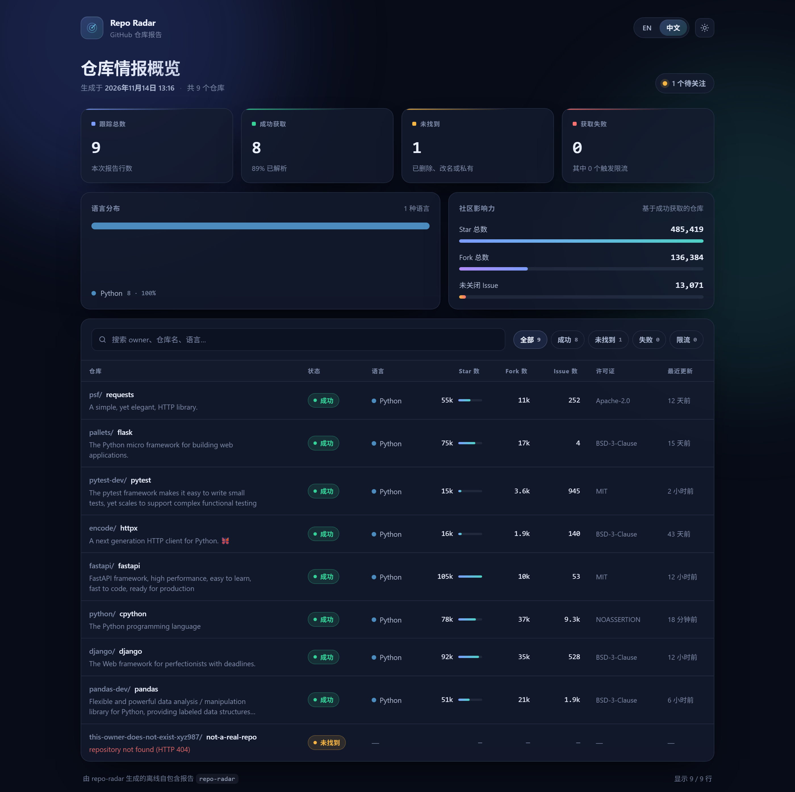

# Repo Radar

[English](README.md) · **简体中文**

把一份 `owner/repository` 清单，变成一份干净、可直接分享的仓库现状快照 —— CSV、JSON，
以及一个可离线打开的 HTML 仪表盘。



<sub>真实运行 `repo-radar sample_repos.csv --output-format all` 的产物：没有假数据，不需要服务器，
一个 HTML 文件即可从本地打开或作为附件发给别人。</sub>

---

## 这个项目解决什么问题

大多数"抓仓库数据"的脚本，本质是一个包着 HTTP 请求的 for 循环。Repo Radar 想做的是那个你会
留在手里的版本：校验输入、尊重 GitHub 的限流规则、隔离单条失败、原子写入报告，并且带一套
完全不联网的测试。

这是一个基于 GitHub 公开 REST API 独立开发的个人作品项目。它是一个测试完备的自动化工具，
不是生产级服务，也不做任何企业级的宣称。

## 功能特性

- **经得起真实表格的输入处理** —— 必填列校验、GitHub 命名规则、首尾空白清理、表头大小写
  不敏感、兼容 Excel 导出的 UTF-8 BOM、自动去重，以及逐行错误隔离：一行写错不会中断整次运行。
- **有主张的 GitHub 客户端** —— 通过 `requests` 调用 `GET /repos/{owner}/{repo}`，带单请求
  超时、指数退避、`Retry-After` 支持（并有硬上限），以及明确的异常类型
  （`RepositoryNotFoundError`、`RateLimitError`、`GitHubServerError`）。
- **有界并发** —— `--workers` 线程池（默认 4，硬上限 32），排队的任务永远不超过能立刻执行的
  数量。无论完成顺序如何，结果始终按输入顺序重新组装。
- **限流感知** —— 触发主限流（HTTP 403 且 `X-RateLimit-Remaining: 0`）时停止本次运行，
  而不是继续打接口；429 / 5xx 会退避重试。
- **三种报告格式** —— CSV、JSON，以及单文件 HTML 仪表盘
  （`--output-format csv|json|html|both|all`）。
- **可离线使用的仪表盘** —— 没有 CDN、没有构建步骤、不需要服务器：KPI 卡片、语言分布、
  社区影响力、搜索、状态筛选、可排序表格、深浅色主题、中英文切换，全在一个文件里。
- **原子写入** —— 先写临时文件再原子替换，进程崩了也不会留下写了一半的 CSV。
- **分层配置** —— 命令行参数 > 环境变量 > `.env` 文件 > 内置默认值，有文档也有测试。
- **可安装** —— `pip install -e .` 后可用 `repo-radar` 命令；`python -m src.main` 同样可用。
- **135 个离线测试** —— 所有 HTTP 全部 mock，结果确定、不联网；再加上 `ruff` 静态检查/
  格式检查，以及覆盖 Python 3.11、3.12、3.13 的 GitHub Actions CI。

## 安装

需要 Python 3.11+。

```bash
git clone https://github.com/<your-account>/repo-radar.git
cd repo-radar

python -m venv .venv
source .venv/bin/activate          # Windows: .venv\Scripts\activate

pip install -e ".[dev]"            # 运行时依赖 + pytest + pytest-cov + ruff
```

未发布到 PyPI，请从仓库克隆安装。

## 快速开始

```bash
repo-radar sample_repos.csv --output-format all
# 等价写法：
python -m src.main sample_repos.csv --output-format all
```

```
output/repository_report.csv     # 扁平表格，18 个固定列
output/repository_report.json    # 相同数据，带一层信封结构
output/repository_report.html    # 上面截图里的仪表盘
```

HTML 文件用任意浏览器打开即可，不需要网络，也不需要服务器。

> 注意：`--output-format` 的默认值仍是 `both`（CSV + JSON），与原行为保持一致；
> 想要 HTML 需显式指定 `html` 或 `all`。

## 命令行参数

| 参数 | 默认值 | 说明 |
| --- | --- | --- |
| `input`（位置参数） | — | 输入 CSV 路径 |
| `--input` | — | 与位置参数相同 |
| `--output-dir` | `output` | 报告输出目录 |
| `--output-format` | `both` | `csv`、`json`、`html`、`both`（csv+json）、`all`（csv+json+html） |
| `--lang` | `en` | HTML 报表的初始语言（`en`、`zh`），页面内可随时切换 |
| `--token` | `$GITHUB_TOKEN` | GitHub Token（更推荐用环境变量） |
| `--timeout` | `10.0` | 单请求超时（秒） |
| `--max-retries` | `3` | 单请求重试次数 |
| `--workers` | `4` | 并发请求数，1–32 |
| `-v, --verbose` | 关闭 | 输出调试日志 |
| `--no-color` | 关闭 | 关闭日志的 ANSI 颜色（也支持 `NO_COLOR` 环境变量） |

### 配置优先级

```
命令行参数  >  环境变量  >  .env 文件  >  内置默认值
```

| 环境变量 | 用途 |
| --- | --- |
| `GITHUB_TOKEN` | GitHub 身份认证 |
| `REPO_RADAR_TIMEOUT` | 单请求超时（秒） |
| `REPO_RADAR_MAX_RETRIES` | 单请求重试次数 |
| `REPO_RADAR_WORKERS` | 并发请求数 |

把 `.env.example` 复制为 `.env`（已在 gitignore 中）即可本地配置；真实环境变量始终覆盖文件内容。
非法取值 —— 超时不是数字、`--workers 0`、`--workers 99` —— 会以退出码 2 结束。

## 输入格式

两列 CSV：`owner` 和 `repository`。多余列会被忽略，首尾空白会被清理，空行跳过，重复项自动去重：

```csv
owner,repository
psf,requests
pallets,flask
pytest-dev,pytest
encode,httpx
fastapi,fastapi
python,cpython
django,django
pandas-dev,pandas
this-owner-does-not-exist-xyz987,not-a-real-repo
```

最后一行是故意写的不存在的仓库，用来演示错误隔离。仓库名会按 GitHub 命名规则校验，
校验失败的行会带上行号写进日志并跳过。

## 输出

### CSV 与 JSON

两个文件都保持固定的列顺序（共 18 列：标识、状态、元数据、时间戳、`error_message`）。

```csv
owner,repository,full_name,status,url,description,language,stars,forks,open_issues,archived,default_branch,license
psf,requests,psf/requests,ok,https://github.com/psf/requests,"A simple, yet elegant, HTTP library.",Python,54698,11433,252,False,main,Apache-2.0
this-owner-does-not-exist-xyz987,not-a-real-repo,...,not_found,...,...,...,0,0,0,False,,,
```

```json
{
  "generated_at": "2026-11-14T13:09:41Z",
  "total": 9,
  "repositories": [
    {
      "owner": "psf",
      "repository": "requests",
      "full_name": "psf/requests",
      "status": "ok",
      "stars": 54698,
      "license": "Apache-2.0",
      "error_message": ""
    }
  ]
}
```

### HTML 仪表盘

一个完全自包含的文件 —— CSS 内联、JS 内联、数据以 JSON 形式嵌入。内容包括：

| 区域 | 展示内容 |
| --- | --- |
| KPI 卡片 | 跟踪总数、成功获取数、未找到数、失败数 |
| 语言分布 | 占比条 + 带数量和百分比的图例 |
| 社区影响力 | 成功获取仓库的 Star / Fork / 未关闭 Issue 总量 |
| 表格 | 状态胶囊、语言、Star（带相对条形）、Fork、Issue、许可证、最近推送 |
| 工具栏 | 全文搜索（按 `/` 聚焦）、状态筛选、可排序列 |
| 页面级 | 深/浅色主题（记忆偏好）、中英文切换、生成时间 |

在文件 URL 后加 `?lang=zh` 或 `?theme=light` 可以固定初始状态，方便截图和文档嵌入。

## 错误处理

每一行输入都恰好对应一行报告，并带一个 `status`：

| 状态 | 含义 |
| --- | --- |
| `ok` | 元数据获取成功 |
| `not_found` | HTTP 404，仓库不存在 |
| `rate_limited` | 触发 GitHub 限流，本次运行提前停止 |
| `error` | 重试后仍然失败的其他 API / 网络错误 |

退出码（方便 cron 与 CI 判断）：

| 退出码 | 含义 |
| --- | --- |
| `0` | 运行完成，至少成功获取一个仓库 |
| `1` | 运行完成，但一个都没能获取到 |
| `2` | 输入或配置非法，或者报告无法写入 |

并发语义是明确的：触发主限流即停止 —— 不再提交新请求，已经在飞的请求允许完成，
尚未开始的条目不会出现在报告里。单个仓库失败不会影响其他仓库，结果始终按输入顺序排列。

## 架构

```
输入 CSV             sample_repos.csv
   ↓
校验                 src/csv_loader.py     CSV 解析、命名规则、去重
   ↓
抓取                 src/processor.py      顺序执行或受限线程池
   ↓                                        （逐项隔离、限流即停）
HTTP / 限流控制      src/github_client.py  超时、重试 + 退避、Retry-After、
   ↓                                        线程级会话、明确的异常类型
数据规整             src/models.py          RepoRequest / RepoReport、REPORT_COLUMNS
   ↓
报告生成             src/report_writer.py  CSV + JSON（原子写入）
                     src/html_report.py    HTML 仪表盘（模板 + 内嵌 JSON）
   ↓
命令行               src/main.py           argparse、配置优先级、退出码
```

依赖约束：只有 `github_client.py` 直接依赖 `requests`。处理器只依赖由命令行层注入的
`RepoClient` 协议（一个方法加明确的异常类型），因此测试可以替换成假客户端，整套测试离线运行。

`src/pagination.py` 是一个经过测试的通用分页工具（`Page`、`paginate()`、解析 GitHub 的
`Link` 响应头），为将来的列表类接口预留；当前的单对象接口不涉及分页，主流程没有用到它。

## 测试

```bash
pytest -q --cov=src --cov-report=term-missing   # 135 个测试，96% 覆盖率
ruff check .                                    # pycodestyle、pyflakes、isort、bugbear
ruff format --check .
```

覆盖范围：输入校验、重试/退避行为（含 `Retry-After` 上限）、错误映射（404 / 403 / 429 /
5xx / 超时 / 非法 JSON）、分页终止条件、并发（输入顺序稳定、真实并行、错误隔离、限流即停）、
配置优先级、`.env` 加载、原子写入、HTML 转义，以及完整的命令行接口。

`scripts/smoke_run.py` 用打桩的 HTTP 层完整跑一遍真实流程，断言三种报告都产出 —— 这就是 CI
执行的端到端检查。

## 持续集成

`.github/workflows/ci.yml` 在每次 push、pull request 和手动触发时运行，权限收紧为
`contents: read`，并会自动取消同一分支上被覆盖的运行：

| Job | 内容 |
| --- | --- |
| `lint` | `ruff check` + `ruff format --check` |
| `test` | Python 3.11 / 3.12 / 3.13 上跑 pytest（覆盖率门槛 90%）、命令行冒烟检查、离线端到端运行 |
| `package` | 构建 sdist + wheel，断言 HTML 模板已被打包，再安装 wheel 并运行控制台命令 |

Dependabot 负责跟踪 pip 与 GitHub Actions 的依赖更新。

## 项目结构

```
.
├── src/
│   ├── config.py              # 默认值、环境变量/.env 解析、硬性上限
│   ├── console.py             # 终端自适应 ANSI 彩色日志
│   ├── models.py              # RepoRequest / RepoReport、REPORT_COLUMNS
│   ├── csv_loader.py          # 输入解析与校验
│   ├── github_client.py       # REST 客户端：超时、重试、异常类型、会话管理
│   ├── processor.py           # 顺序/并发执行、错误隔离
│   ├── report_writer.py       # CSV + JSON，原子写入
│   ├── html_report.py         # HTML 仪表盘生成
│   ├── pagination.py          # 通用分页工具（留给未来接口）
│   ├── main.py                # 命令行入口与运行编排
│   └── templates/
│       └── dashboard.html     # 仪表盘的结构、样式与渲染脚本
├── tests/                     # 135 个离线 pytest 测试
├── scripts/smoke_run.py       # CI 使用的离线端到端检查
├── docs/                      # README 截图
├── sample_repos.csv           # 示例输入（8 个真实仓库 + 1 个故意的 404）
├── pyproject.toml             # 打包、控制台命令、pytest/ruff/coverage 配置
└── .github/                   # CI 工作流 + Dependabot
```

## 已知边界

直说，这个工具目前**不**做这些事：

- 只抓单仓库元数据 —— 列表、搜索、贡献者、Release 等接口都还没实现
  （`src/pagination.py` 是为它们准备的积木）；
- 不做任何持久化（没有数据库，也没有增量/差量运行）；
- 不提供异步 IO，也不支持 GitHub 以外的数据源（只有线程，只有一个客户端）；
- 遇到主限流不会排队续跑，而是停止并如实上报 —— 在一次命令里干等一小时，对批量工具来说
  不是有用的行为；
- 不发布到 PyPI，也没有签名发行版。

在未认证的 60 次/小时额度下，输入超过约 60 个仓库就会提前停止，除非配置了 Token。

## Security

- **Token handling** — the GitHub token is read from `GITHUB_TOKEN` (or `--token`) and
  only ever reported as "provided"; it is never logged, echoed or written to a report.
  `.env` is gitignored.
- **Read-only by design** — the client only performs `GET /repos/{owner}/{repo}`. No
  write scope is required; a token with no scopes at all is enough.
- **Untrusted text** — repository names and descriptions are remote input. The
  dashboard escapes every value and embeds the payload with `</` neutralised, so a
  description cannot break out of the script block or inject markup.
- **Report files** — CSV cells are written verbatim, which is what you want in a data
  file. Be aware that a spreadsheet will treat a description starting with `=` as a
  formula, so import untrusted reports as text rather than double-clicking them.
- **No telemetry** — nothing leaves the machine except the GitHub API calls.

Please report security issues privately rather than in a public issue.

## License

MIT — see [LICENSE](LICENSE).
